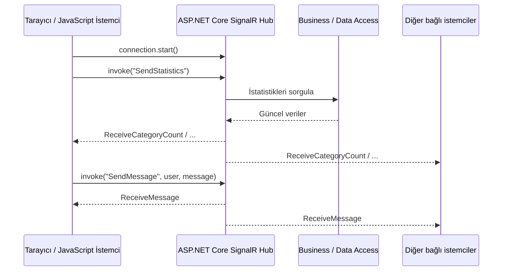
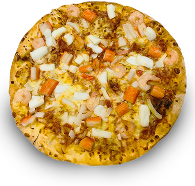
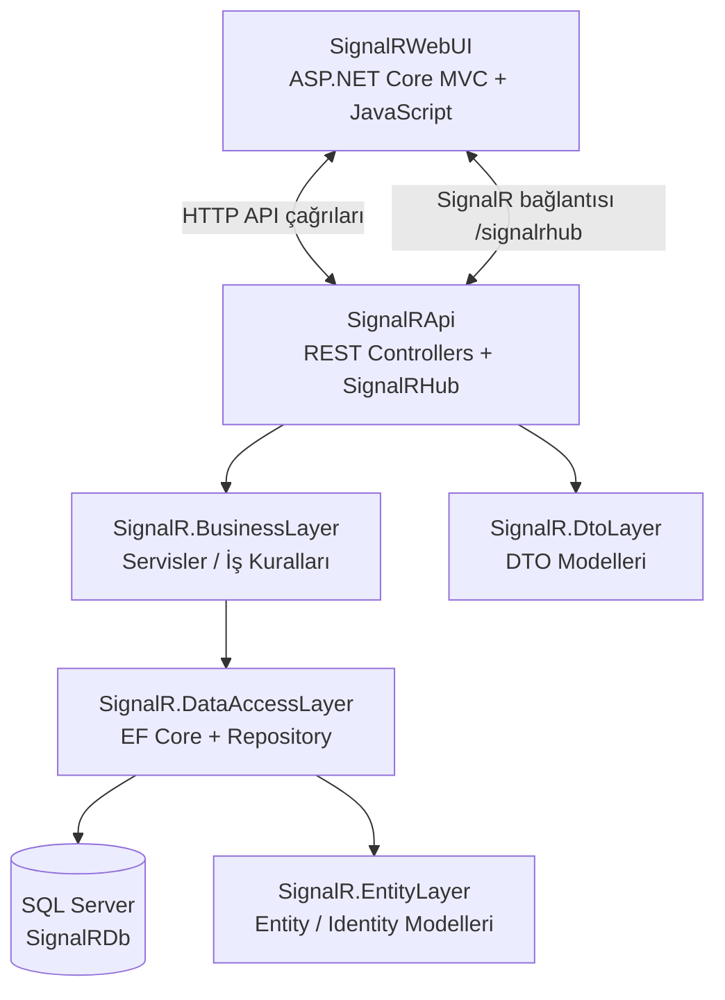

<div align="center">

# ⚡ SignalR Restaurant Management

### ASP.NET Core SignalR ile Gerçek Zamanlı Restoran Yönetimi

**Bu projenin temel amacı, ASP.NET Core SignalR teknolojisini gerçek bir restoran senaryosunda uygulamak; sunucu ve istemciler arasında çift yönlü, anlık veri iletişimini deneyimlemektir.**


[🔌 SignalR Özellikleri](#-signalr-ile-neler-yapılıyor) · [🖼️ Görseller](#️-proje-görselleri) · [🏗️ Mimari](#️-proje-mimarisi) · [🚀 Kurulum](#-kurulum-ve-çalıştırma)


<sub>Kapak görseli, projenin mevcut restoran arayüzü varlıklarından alınmıştır; çalışan uygulama ekran görüntüsü değildir.</sub>

</div>

---

## 🎯 Projenin Amacı

Bu çalışma, yalnızca bir restoran otomasyonu geliştirmekten ziyade **SignalR Hub–Client iletişimini, sunucudan istemciye yayın yapmayı ve birden fazla istemcinin eşzamanlı güncellenmesini öğrenmeye** odaklanır. Restoran yönetim senaryosu ise bu iletişimi somutlaştırmak için kullanılmıştır.

SignalR'ın kullanıldığı örnekler: **canlı istatistik panelleri, masa dolu/boş durumları, okunmamış bildirimler, rezervasyon listeleri, anlık mesajlaşma ve çevrimiçi bağlantı sayısı.**

> [!NOTE]
> Bu projede bazı ekranlar, belirli aralıklarla Hub metotlarını `invoke` ederek veriyi talep eder (örneğin istatistikler 1 saniyede, masa durumları ve bildirimler 2 saniyede bir). Hub, sonuçları `Clients.All.SendAsync(...)` ile bağlı istemcilere yayınlar. Yani güncel uygulamadaki tüm yenilemeler veri değişiminde otomatik tetiklenen olay tabanlı yayınlar değildir.

## 🔌 SignalR ile Neler Yapılıyor?

| Senaryo | Hub metodu | İstemciye yayınlanan olay | Kullanım amacı |
| --- | --- | --- | --- |
| 📊 Canlı istatistikler | `SendStatistics` | `ReceiveCategoryCount`, `ReceiveProductCount`, `ReceiveTotalOrderCount` vb. | Kategori, ürün, sipariş, kasa ve fiyat verilerini görüntüleme |
| 📈 Anlık göstergeler | `SendProgress` | `ReceiveActiveOrderCount`, `ReceiveMenuTableCount` vb. | Yönetim ekranındaki gösterge verilerini güncelleme |
| 🪑 Masa durumları | `SendMenuTable` | `ReceiveMenuTables` | Masaların dolu/boş bilgilerini yayınlama |
| 🔔 Bildirimler | `SendNotifications` | `ReceiveNotificationCountByFalse`, `ReceiveNotificationListByFalse` | Okunmamış bildirim sayısını ve listesini gösterme |
| 📅 Rezervasyonlar | `SendBookingList` | `ReceiveBookingList` | Rezervasyon listesini bağlı istemcilere iletme |
| 💬 Anlık mesajlaşma | `SendMessage(user, message)` | `ReceiveMessage` | Kullanıcı mesajlarını tüm bağlı istemcilere yayınlama |
| 👥 Bağlı istemciler | `OnConnectedAsync`, `OnDisconnectedAsync` | `ReceiveClientCount` | Aktif bağlantı sayısını yayınlama |

<details>
<summary><b>🔎 SignalR iletişim akışını göster</b></summary>



**Önemli:** SignalR, istemci ve sunucu arasında kalıcı iletişim kurar; mevcut istatistik ekranında ise istemci belirli aralıklarla verinin yayınlanmasını ayrıca ister.

</details>

<details>
<summary><b>💻 Gerçek projeden Hub ve JavaScript örneğini göster</b></summary>

**Sunucu tarafı — `SignalRApi/Hubs/SignalRHub.cs` içindeki mesajlaşma:**

```csharp
public async Task SendMessage(string user, string message)
{
    await Clients.All.SendAsync("ReceiveMessage", user, message);
}
```

**İstemci tarafı — `SignalRWebUI/wwwroot/js/chat.js` yapısından örnek:**

```javascript
const connection = new signalR.HubConnectionBuilder()
    .withUrl("https://localhost:7067/SignalRHub")
    .build();

connection.on("ReceiveMessage", (user, message) => {
    console.log(`${user}: ${message}`);
});

connection.start().catch(console.error);

// Bağlantı kurulduktan sonra çağrılır:
// connection.invoke("SendMessage", "Kullanıcı", "Merhaba!");
```

> Yukarıdaki JavaScript kodu, projedeki bağlantı ve olay yakalama mantığının sadeleştirilmiş gösterimidir. Tam uygulamayı `chat.js` dosyasında inceleyebilirsiniz.

</details>

## 🖼️ Proje Görselleri

<details open>
<summary><b>🍔 Restoran arayüzü ve ürün görsellerini aç / kapat</b></summary>

<p align="center">
  
  
  
</p>

<sub>Bu görseller depoda bulunan statik arayüz varlıklarıdır; canlı istatistik veya sohbet ekranının ekran görüntüleri değildir.</sub>

</details>

<details>
<summary><b>📸 Canlı SignalR ekranları: nerelerde bulunuyor?</b></summary>

Gerçek çalışan uygulama ekranlarını görmek için projeyi başlattıktan sonra aşağıdaki MVC sayfalarını ziyaret edebilirsiniz:

| Ekran | Projedeki görünüm | SignalR işlevi |
| --- | --- | --- |
| Canlı istatistik paneli | `Views/Statistic/Index.cshtml` | Anlık KPI ve istatistik değerleri |
| İlerleme / gösterge paneli | `Views/ProgressBars/Index.cshtml` | Hub verileriyle güncellenen göstergeler |
| Masa durumları | `Views/MenuTables/TableListByStatus.cshtml` | Dolu / boş masa bilgileri |
| Mesajlaşma | `Views/Message/Index.cshtml` | Gerçek zamanlı sohbet |
| Bağlı istemciler | `Views/Message/ClientUserCount.cshtml` | Aktif bağlantı sayısı |
| Bildirim alanı | `Views/Shared/Components/AdminLayoutNavbar/Default.cshtml` | Okunmamış bildirimler |

> Depoda bu ekranlara ait hazır screenshot dosyaları bulunmadığından, mevcut olmayan görüntüler yerine gerçek kaynak dosyalara yönlendirme yapıldı. Sonradan alınacak ekran görüntüleri `docs/images/` altında saklanarak bu bölüme eklenebilir.

</details>

## 🏗️ Proje Mimarisi

<details>
<summary><b>🧩 Katmanlı mimari şemasını göster</b></summary>



</details>

<details>
<summary><b>📂 Solution ve katmanların görevlerini göster</b></summary>

```text
SignalRProject.slnx
├── SignalRApi/                 # Web API, REST controller'lar, SignalRHub
├── SignalRWebUI/               # MVC arayüzü, Razor Views, SignalR JS istemcileri
├── SignalR.BusinessLayer/      # Servis arayüzleri ve iş mantığı
├── SignalR.DataAccessLayer/    # EF Core, DbContext, repository, migrations
├── SignalR.DtoLayer/           # Veri aktarım modelleri
└── SignalR.EntityLayer/        # Veritabanı varlıkları ve Identity sınıfları
```

</details>

## 🛠️ Kullanılan Teknolojiler

| Alan | Teknoloji |
| --- | --- |
| Gerçek zamanlı iletişim | **ASP.NET Core SignalR** |
| Backend | ASP.NET Core Web API (**.NET 6**) |
| Frontend | ASP.NET Core MVC / Razor Views, JavaScript, jQuery |
| Veri erişimi | Entity Framework Core 6, SQL Server |
| Kimlik doğrulama | ASP.NET Core Identity |
| Veri aktarımı / eşleme | DTO, AutoMapper |
| Doğrulama | FluentValidation |
| API dokümantasyonu | Swagger / Swashbuckle |
| Arayüz | Bootstrap ve mevcut restoran / yönetim şablonları |

## 🚀 Kurulum ve Çalıştırma

<details>
<summary><b>1️⃣ Gereksinimler ve projeyi indirme</b></summary>

- .NET **6 SDK** (projenin mevcut hedef framework'ü; .NET 6 artık destek dışıdır, güncelleme önerilir)
- SQL Server veya SQL Server Express
- Visual Studio ya da .NET CLI

```bash
git clone https://github.com/HalilGorkemUysal/SignalRProject.git
cd SignalRProject
dotnet restore SignalRProject.slnx
```

> `.slnx` çözüm dosyası için bu formatı destekleyen güncel SDK / IDE kullanılmalıdır. Alternatif olarak proje `.csproj` dosyaları üzerinden ayrı ayrı çalıştırılabilir.

</details>

<details>
<summary><b>2️⃣ Veritabanı bağlantısını yapılandırma</b></summary>

`SignalR.DataAccessLayer/Concrete/SignalRContext.cs` dosyasındaki `OnConfiguring` metodu, geliştirme makinesine özgü bir SQL Server bağlantı dizesi kullanıyor. Çalıştırmadan önce bağlantıyı **kendi SQL Server ortamınıza göre** düzenleyin.

```csharp
optionsBuilder.UseSqlServer(
    "Server=YOUR_SERVER;Database=SignalRDb;Trusted_Connection=True;TrustServerCertificate=True;");
```

Bu yalnızca **yerel geliştirme için örnek** bir bağlantı dizesidir. Gerçek dağıtımlarda bağlantı bilgilerini kaynak kod yerine yapılandırma veya gizli bilgi yönetimi üzerinden sağlayın.

Veritabanı migration'larını uygulamak için:

```bash
dotnet tool install --global dotnet-ef --version 6.0.30
dotnet ef database update --project SignalR.DataAccessLayer --startup-project SignalRApi
```

> `dotnet-ef` zaten yüklüyse uygun sürüme güncelleyebilirsiniz. Migration sırasında bağlantı ayarlarının doğru olduğundan emin olun.

</details>

<details>
<summary><b>3️⃣ API ve MVC uygulamasını başlatma</b></summary>

**Terminal 1 — API:**

```bash
dotnet run --project SignalRApi --launch-profile SignalRApi
```

**Terminal 2 — Web UI:**

```bash
dotnet run --project SignalRWebUI --launch-profile SignalRWebUI
```

Depodaki `launchSettings.json` dosyalarına göre geliştirme adresleri:

| Servis | Varsayılan adres |
| --- | --- |
| API | `https://localhost:7067` |
| Swagger (Development) | `https://localhost:7067/swagger` |
| SignalR Hub | `https://localhost:7067/signalrhub` |
| MVC arayüzü | `https://localhost:7092` |

**Dikkat:** SignalR JavaScript istemcileri API'ye `https://localhost:7067/SignalRHub` üzerinden bağlanacak şekilde yazılmıştır. API portunu değiştirirseniz istemci URL'lerini de düzenleyin. HTTPS geliştirme sertifikası gerekiyorsa `dotnet dev-certs https --trust` kullanılabilir.

> `SignalRWebUI.csproj` dosyasında `QRCoder.dll` için geliştiricinin yerel `Downloads` klasörüne işaret eden bir referans var. Farklı bir bilgisayarda derleme sorunu yaşanırsa bu referansın taşınabilir bir NuGet paketine veya projeye dahil edilmiş DLL'e dönüştürülmesi gerekebilir.

</details>

## 🧠 Öğrenilen / Gösterilen SignalR Kavramları

<details>
<summary><b>📚 Teknik kazanımları göster</b></summary>

- `Hub` sınıfı ve `MapHub<SignalRHub>("/signalrhub")` endpoint eşlemesi
- `HubConnectionBuilder` ile JavaScript istemci bağlantısı
- `connection.start()` ile bağlantıyı başlatma
- `connection.invoke(...)` ile sunucudaki Hub metodunu çağırma
- `connection.on(...)` ile istemcide olay dinleme
- `Clients.All.SendAsync(...)` ile bağlı istemcilere yayın yapma
- `OnConnectedAsync` ve `OnDisconnectedAsync` ile bağlantı yaşam döngüsünü izleme
- SignalR'dan gelen verileri sayfayı yeniden yüklemeden DOM üzerinde gösterme

</details>

## 🔍 Geliştirme Notları

<details>
<summary><b>🧰 İyileştirme önerilerini göster</b></summary>

Bu maddeler mevcut projede tamamlanmış özellikler değil, kod incelemesinden çıkan geliştirme fikirleridir:

1. **Gerçek push modeli:** İstatistikleri her saniye Hub üzerinden sorgulamak yerine, veri değişikliklerinde ilgili istemcilere yayın yapma.
2. **Bağlantı dayanıklılığı:** JavaScript istemcilerine `withAutomaticReconnect()` ve bağlantı hata/yeniden bağlanma yönetimi ekleme.
3. **İstemci sayacı:** `static int clientCount` yerine eşzamanlı erişim ve çoklu sunucu senaryolarına uygun bağlantı takibi.
4. **Güvenli yapılandırma:** SQL Server bağlantı dizesini koddan çıkarma; SignalR CORS politikasını bilinen origin'lerle sınırlandırma.
5. **Taşınabilir derleme:** Yerel dosya yoluyla eklenen `QRCoder.dll` bağımlılığını paket yönetimine taşıma.
6. **Güncel platform:** Destek süresi bitmiş .NET 6'dan desteklenen bir .NET sürümüne geçiş planlama.

</details>

---

<div align="center">

**⚡ Projenin odağı: SignalR ile gerçek zamanlı istemci–sunucu iletişimi.**

Restoran yönetimi, bu iletişimin istatistikler, masa durumları, mesajlaşma ve bildirimler üzerinden uygulandığı örnek bir kullanım alanıdır.

**Geliştirici:** [HalilGorkemUysal](https://github.com/HalilGorkemUysal)  
**Kaynak kod:** [SignalRProject](https://github.com/HalilGorkemUysal/SignalRProject)

</div>
