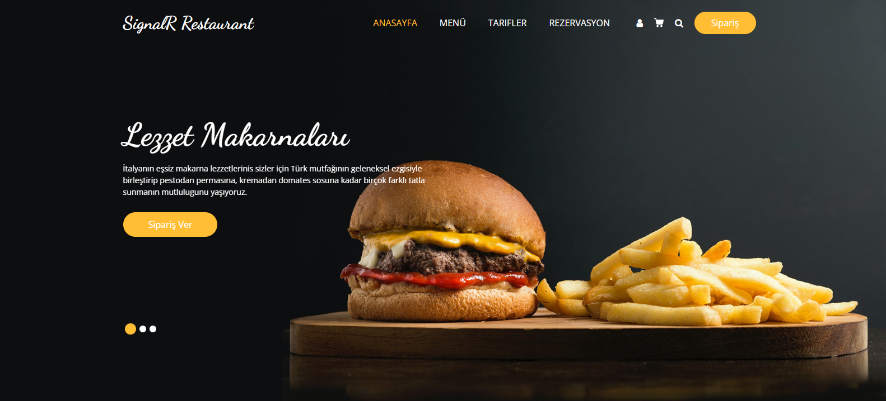
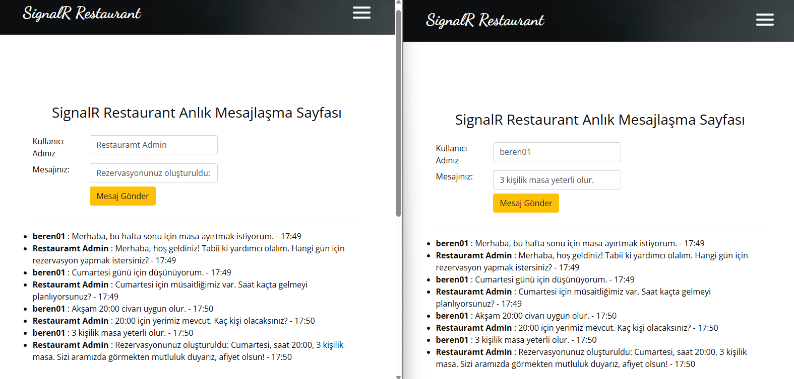
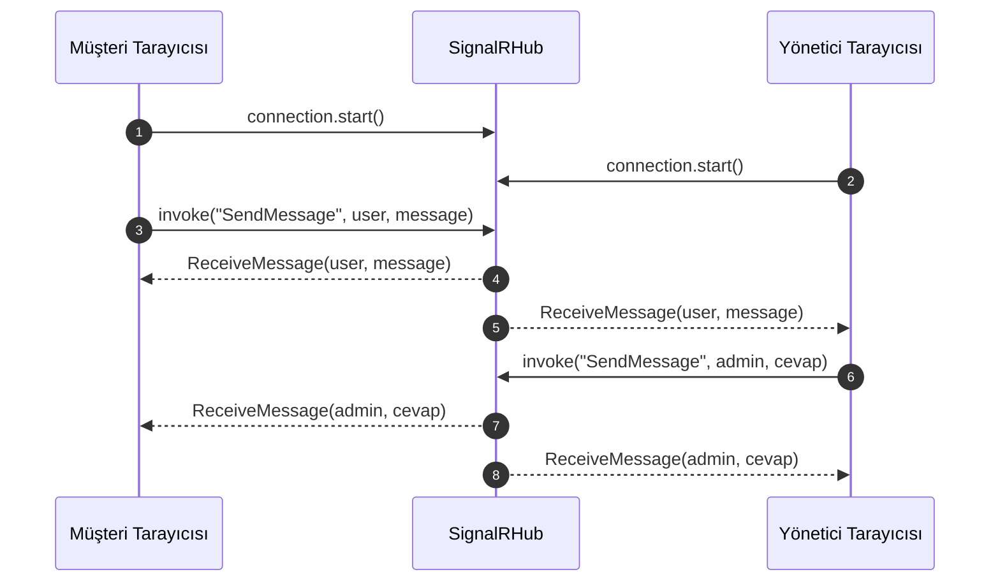
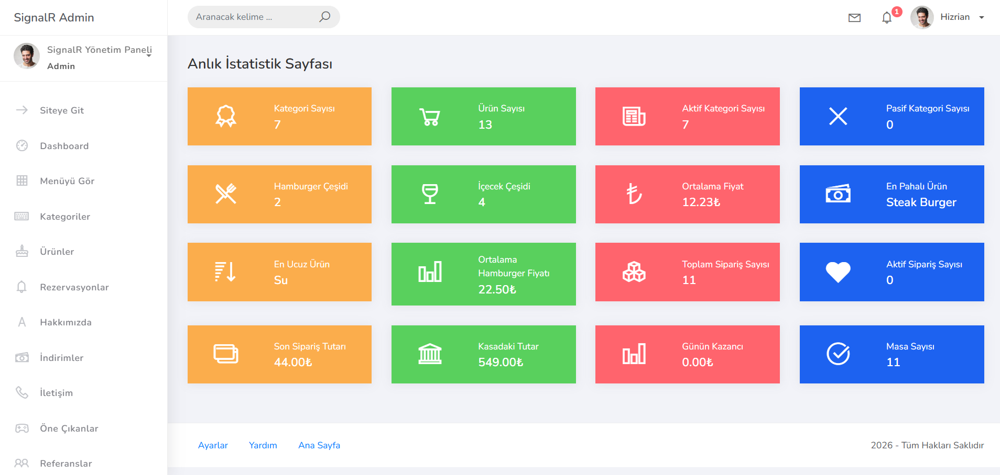
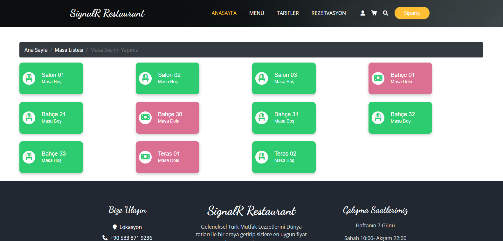
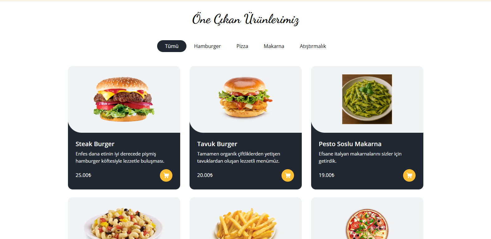
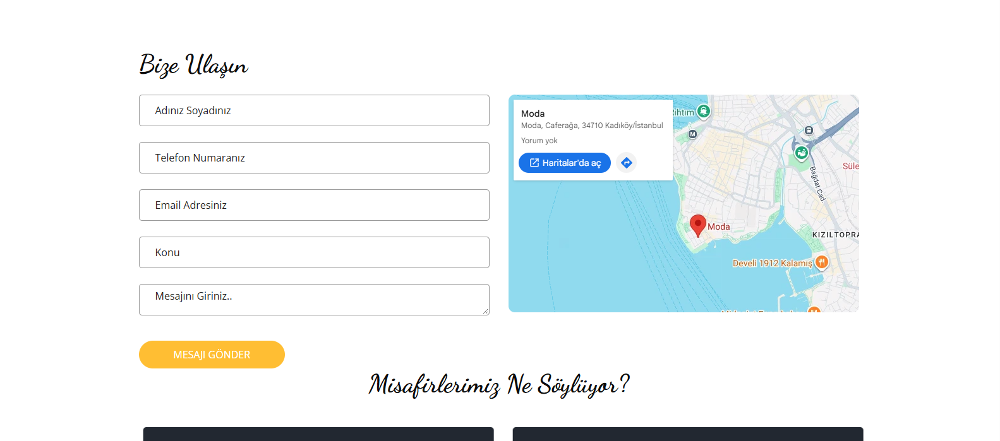
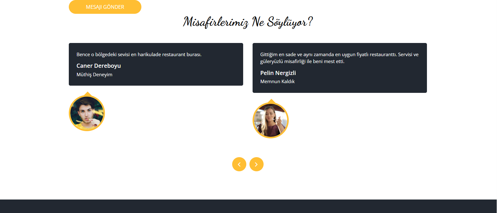
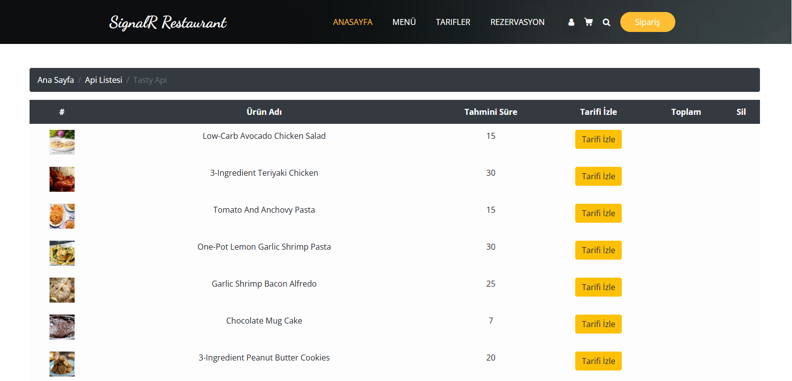
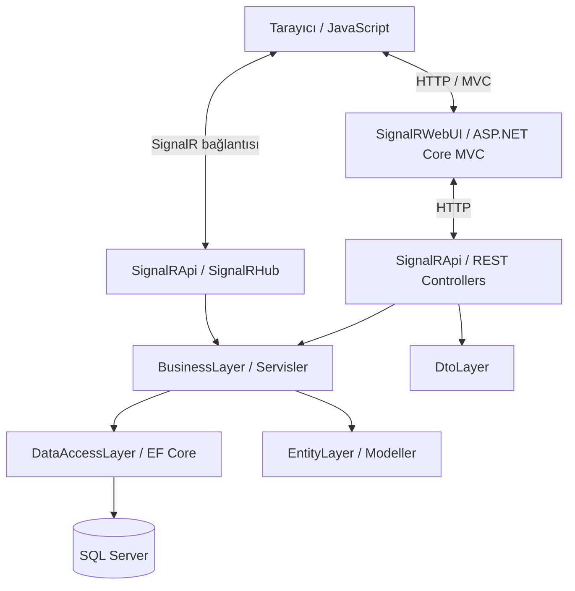

<div align="center">

# ⚡ SignalR Restaurant

### ASP.NET Core SignalR ile Gerçek Zamanlı Restoran Yönetimi ve Canlı İletişim

**Bu projenin asıl amacı, ASP.NET Core SignalR teknolojisini uygulamalı olarak öğrenmek ve gerçek senaryolarda istemci–sunucu arasında çift yönlü, eş zamanlı veri iletişimi kurmaktır.** Restoran otomasyonu; sohbet, canlı istatistik, bildirim ve masa yönetimi gibi SignalR senaryolarını göstermek için geliştirilmiştir.


[**💬 Canlı Mesajlaşma**](#-1-canlı-mesajlaşma--signalrın-en-net-örneği) · [**📊 Anlık İstatistikler**](#-2-anlık-istatistikler-ve-göstergeler) · [**🔔 Diğer SignalR Senaryoları**](#-3-diğer-signalr-senaryoları) · [**📷 Ekran Görüntüleri**](#-proje-ekran-görüntüleri) · [**🚀 Kurulum**](#-kurulum-ve-çalıştırma)



<sub>Gerçek uygulama ekran görüntüsü · ASP.NET Core MVC arayüzü</sub>

</div>

---

## 🎯 Neden Bu Proje?

SignalR, tarayıcı ve sunucu arasında kalıcı bir bağlantı üzerinden **sunucunun istemcilere veri göndermesini** ve **istemcilerin Hub metotlarını çağırmasını** sağlar. Bu projede bu yaklaşım tek bir sohbet örneğiyle sınırlı kalmaz; restoranın yönetim ve müşteri ekranlarına da uyarlanır.

- **Çift yönlü iletişim:** Tarayıcıdan Hub'a mesaj gönderme ve Hub'dan tüm bağlı istemcilere yayın yapma.
- **Çoklu istemci senaryosu:** Aynı sohbetin iki farklı tarayıcıda eş zamanlı gösterilmesi.
- **Canlı yönetim ekranları:** İstatistikler, göstergeler, rezervasyonlar, bildirimler ve masa durumlarının SignalR üzerinden güncellenmesi.
- **Bağlantı yaşam döngüsü:** İstemci bağlandığında/ayrıldığında aktif bağlantı sayısının yayınlanması.

> [!IMPORTANT]
> **Teknik ayrıntı:** Sohbet ve bağlantı sayısı SignalR olaylarıyla anlık yayınlanır. İstatistik, rezervasyon, bildirim ve masa ekranlarında ise JavaScript belirli aralıklarla `connection.invoke(...)` çağırır; Hub güncel veriyi `Clients.All.SendAsync(...)` ile yayınlar. Bu nedenle mevcut sürümde tüm ekranlar veritabanı değişikliğini doğrudan dinleyen, tamamen olay-tetiklemeli bir mimaride değildir.

## 🔌 SignalR Nerelerde Kullanılıyor?

| SignalR senaryosu | Hub metodu / sunucu olayı | JavaScript'in dinlediği olay | Kodda kullanıldığı yer |
|:--|:--|:--|:--|
| 💬 Anlık mesajlaşma | `SendMessage(user, message)` | `ReceiveMessage` | `wwwroot/js/chat.js` |
| 📊 Canlı istatistikler | `SendStatistics` | `ReceiveCategoryCount`, `ReceiveProductCount`, `ReceiveTotalOrderCount` ve diğerleri | `Views/Statistic/Index.cshtml` |
| 📈 Canlı göstergeler | `SendProgress` | `ReceiveActiveOrderCount`, `ReceiveMenuTableCount` ve diğerleri | `Views/ProgressBars/Index.cshtml` |
| 🪑 Yönetim panelinde masa durumları | `SendMenuTable` | `ReceiveMenuTables` | `Views/MenuTables/TableListByStatus.cshtml` |
| 🔔 Bildirimler | `SendNotifications` | `ReceiveNotificationCountByFalse`, `ReceiveNotificationListByFalse` | `Views/Shared/Components/AdminLayoutNavbar/Default.cshtml` |
| 📅 Rezervasyon listesi | `SendBookingList` | `ReceiveBookingList` | `Views/Booking/Index.cshtml` |
| 👥 Bağlı istemci sayısı | `OnConnectedAsync` / `OnDisconnectedAsync` | `ReceiveClientCount` | `Views/Message/ClientUserCount.cshtml` |

**Merkezi Hub:** [`SignalRApi/Hubs/SignalRHub.cs`](SignalRApi/Hubs/SignalRHub.cs)  
**Hub adresi:** `/signalrhub` (API geliştirme profilinde `https://localhost:7067/signalrhub`)

---

## 💬 1. Canlı Mesajlaşma — SignalR'ın En Net Örneği

Bu uygulamanın gerçek zamanlı iletişimi en görünür biçimde gösteren bölümü **çoklu istemcili sohbet ekranıdır.** İki farklı tarayıcıda açık olan sohbet sayfalarından birinde gönderilen mesaj, sayfa yenilemeye gerek olmadan diğerinde de görüntülenir. Ekran görüntüsünde müşteri ile restoran yöneticisinin aynı konuşmayı eş zamanlı gördüğü senaryo yer alır.

<div align="center">

<br/>
<sub>Gerçek uygulama: müşteri ve restoran yöneticisi arasında eş zamanlı sohbet</sub>
</div>

**Mesajın izlediği yol:** `Kullanıcı → connection.invoke("SendMessage", ...) → SignalRHub → Clients.All.SendAsync("ReceiveMessage", ...) → Tüm bağlı sohbet istemcileri`

<details>
<summary><b>🔍 Sohbetin işleyişini adım adım göster</b></summary>

1. Tarayıcı `HubConnectionBuilder` ile `/SignalRHub` adresine bağlanır.
2. `connection.start()` başarılı olduğunda mesaj gönderme düğmesi kullanılabilir olur.
3. Gönderen kullanıcı adı ve mesajı `connection.invoke("SendMessage", user, message)` ile Hub'a iletilir.
4. Hub `Clients.All.SendAsync("ReceiveMessage", user, message)` çağrısıyla mesajı tüm bağlı istemcilere dağıtır.
5. Her istemci `connection.on("ReceiveMessage", ...)` ile mesajı alır ve sayfadaki mesaj listesine ekler.
6. Görünen saat, istemcide mesaj alındığında JavaScript tarafından hesaplanır.

Bu uygulamadaki sohbet **tüm bağlı istemcilere yayın** yapar; özel mesaj/oda ayrımı ve kalıcı mesaj geçmişi bu kod parçasında uygulanmamıştır.

</details>

<details>
<summary><b>💻 Gerçek kod: Hub tarafında SendMessage</b></summary>

[`SignalRApi/Hubs/SignalRHub.cs`](SignalRApi/Hubs/SignalRHub.cs):

```csharp
public async Task SendMessage(string user, string message)
{
    await Clients.All.SendAsync("ReceiveMessage", user, message);
}
```

`Clients.All` kullanımı nedeniyle bir mesaj yalnızca gönderen kullanıcıya değil, Hub'a bağlı tüm istemcilere yayınlanır.

</details>

<details>
<summary><b>💻 Gerçek kod: JavaScript bağlantısı, mesaj alma ve gönderme</b></summary>

[`SignalRWebUI/wwwroot/js/chat.js`](SignalRWebUI/wwwroot/js/chat.js) içindeki işleyişten seçilmiş kod:

```javascript
var connection = new signalR.HubConnectionBuilder()
    .withUrl("https://localhost:7067/SignalRHub")
    .build();

document.getElementById("sendbutton").disabled = true;

connection.on("ReceiveMessage", function (user, message) {
    var currentTime = new Date();
    var currentHour = currentTime.getHours();
    var currentMinute = String(currentTime.getMinutes()).padStart(2, "0");

    var li = document.createElement("li");
    var span = document.createElement("span");
    span.style.fontWeight = "bold";
    span.textContent = user;
    li.appendChild(span);
    li.appendChild(document.createTextNode(
        ` : ${message} - ${currentHour}:${currentMinute}`
    ));
    document.getElementById("messagelist").appendChild(li);
});

connection.start().then(function () {
    document.getElementById("sendbutton").disabled = false;
}).catch(function (err) {
    return console.error(err.toString());
});

document.getElementById("sendbutton").addEventListener("click", function (event) {
    var user = document.getElementById("userinput").value;
    var message = document.getElementById("messageinput").value;
    connection.invoke("SendMessage", user, message)
        .catch(function (err) { return console.error(err.toString()); });
    event.preventDefault();
});
```

Sohbetin Razor arayüzü: [`Views/Message/Index.cshtml`](SignalRWebUI/Views/Message/Index.cshtml).

</details>

<details>
<summary><b>🧭 Mesajlaşma akış diyagramını aç</b></summary>



</details>

---

## 📊 2. Anlık İstatistikler ve Göstergeler

**SignalR yalnızca mesajlaşma için değil, yönetim panellerinde verilerin canlı gösterilmesi için de kullanılıyor.** İstatistik ekranında kategori sayısı, ürün sayısı, aktif/pasif kategoriler, ürün fiyatları, siparişler, kasa tutarı ve masa sayısı gibi veriler Hub aracılığıyla istemciye aktarılır.

<div align="center">

<br/>
<sub>Gerçek uygulama: SignalR ile beslenen 16 istatistik kartı</sub>
</div>

<details>
<summary><b>🔍 İstatistik yayınlarının nasıl çalıştığını göster</b></summary>

`Views/Statistic/Index.cshtml` içinde bağlantı başlatıldıktan sonra **her 1 saniyede** `SendStatistics` Hub metodu çağrılır:

```javascript
var connection = new signalR.HubConnectionBuilder()
    .withUrl("https://localhost:7067/SignalRHub")
    .build();

connection.start().then(() => {
    setInterval(() => {
        connection.invoke("SendStatistics");
    }, 1000);
});

connection.on("ReceiveCategoryCount", (value) => {
    $("#categorycount").text(value);
});

connection.on("ReceiveProductCount", (value) => {
    $("#productcount").text(value);
});
```

Hub tarafında servislerden okunan veriler farklı `Receive...` olayları üzerinden tüm bağlı istemcilere gönderilir. Örneğin:

```csharp
public async Task SendStatistics()
{
    var value = _categoryService.TCategoryCount();
    await Clients.All.SendAsync("ReceiveCategoryCount", value);

    var value2 = _productService.TProductCount();
    await Clients.All.SendAsync("ReceiveProductCount", value2);

    // Diğer istatistikler de ilgili Receive... olaylarıyla yayınlanır.
}
```

Benzer şekilde `Views/ProgressBars/Index.cshtml` içinde `SendProgress` metodu **1 saniyelik aralıklarla** çağrılarak göstergeler güncellenir.

</details>

---

## 🔔 3. Diğer SignalR Senaryoları

<details>
<summary><b>🪑 Masa doluluk durumları — ReceiveMenuTables</b></summary>

Yönetim panelindeki `Views/MenuTables/TableListByStatus.cshtml`, **2 saniyede bir** `SendMenuTable` çağırır. Hub `_menuTableService.TGetListAll()` ile masaları alıp `ReceiveMenuTables` olayına yayınlar. İstemci masa kartlarını dolu/boş durumlarına göre yeniden oluşturur.

```csharp
public async Task SendMenuTable()
{
    var values = _menuTableService.TGetListAll();
    await Clients.All.SendAsync("ReceiveMenuTables", values);
}
```



> **Ekran ayrımı:** Görseldeki müşteri masa seçim ekranı `Views/CustomerTable/CustomerTableList.cshtml` içinde **Razor ile sunucu tarafında** oluşturulur. SignalR üzerinden güncellenen masa kartları ise ayrı bir yönetim ekranı olan `Views/MenuTables/TableListByStatus.cshtml` içindedir. Bu görsel, masa yönetimi özelliğinin müşteri arayüzünü göstermektedir.

</details>

<details>
<summary><b>🔔 Canlı bildirim sayısı ve listesi — ReceiveNotification...</b></summary>

Yönetim panelinin üst menüsündeki `AdminLayoutNavbar` bileşeni **2 saniyede bir** `SendNotifications` çağırır. Hub, okunmamış bildirimlerin sayısını ve listesini yayınlar:

```csharp
public async Task SendNotifications()
{
    var values = _notificationService.TNotificationCountByStatusFalse();
    await Clients.All.SendAsync("ReceiveNotificationCountByFalse", values);

    var values2 = _notificationService.TGetAllNotificationByFalse();
    await Clients.All.SendAsync("ReceiveNotificationListByFalse", values2);
}
```

İstemci `ReceiveNotificationCountByFalse` ile bildirim rozetini, `ReceiveNotificationListByFalse` ile açılır bildirim listesini günceller. Örneğin istatistik ekran görüntüsünün üst köşesinde bildirim rozeti görülebilir.

</details>

<details>
<summary><b>📅 Rezervasyon listesinin güncellenmesi — ReceiveBookingList</b></summary>

`Views/Booking/Index.cshtml` ekranında **2 saniyelik aralıklarla** `SendBookingList` çağrılır. Hub rezervasyon listesini servis katmanından alıp `ReceiveBookingList` olayıyla yayınlar. JavaScript bu veriden yeni bir HTML tablo oluşturur. Liste onaylama, iptal etme ve güncelleme işlemleri için bağlantılar içerir.

```csharp
public async Task SendBookingList()
{
    var values = _bookingService.TGetListAll();
    await Clients.All.SendAsync("ReceiveBookingList", values);
}
```

Bu yöntem, açık rezervasyon listesinin yeniden sayfa yüklenmeden güncellenmesini sağlar.

</details>

<details>
<summary><b>👥 Bağlanan ve ayrılan istemcilerin sayısı — ReceiveClientCount</b></summary>

`SignalRHub` bağlantı yaşam döngüsü metotlarını ezerek istemci sayısını yayınlar:

```csharp
public static int clientCount { get; set; } = 0;

public override async Task OnConnectedAsync()
{
    clientCount++;
    await Clients.All.SendAsync("ReceiveClientCount", clientCount);
    await base.OnConnectedAsync();
}

public override async Task OnDisconnectedAsync(Exception? exception)
{
    clientCount--;
    await Clients.All.SendAsync("ReceiveClientCount", clientCount);
    await base.OnDisconnectedAsync(exception);
}
```

`Views/Message/ClientUserCount.cshtml` tarafında `ReceiveClientCount` dinlenir. Bu sayı, mevcut kodda **bağlantı sayısıdır**, benzersiz kimliği doğrulanmış kullanıcı sayısı değildir; `static int` yaklaşımı tek sunucu içi örnek için uygundur, çoklu sunucu/senkronizasyon ve eşzamanlılık açısından geliştirme gerektirir.

</details>

---

## 📷 Proje Ekran Görüntüleri

Aşağıdaki görüntüler doğrudan çalışan uygulamadan alınmıştır. SignalR'ın belirgin olduğu sohbet ve istatistik ekranları yukarıda ayrıca öne çıkarılmıştır; diğerleri restoran senaryosunun kapsamını gösterir.

<details>
<summary><b>🏠 Restoran ana sayfasını göster</b></summary>


</details>

<details>
<summary><b>🍔 Ürün menüsünü göster</b></summary>



</details>

<details>
<summary><b>🪑 Masa seçimi ekranını göster</b></summary>


</details>

<details>
<summary><b>✉️ İletişim sayfasını göster</b></summary>



</details>

<details>
<summary><b>⭐ Müşteri yorumlarını göster</b></summary>



</details>

<details>
<summary><b>🍽️ Harici yemek tarifi API ekranını göster</b></summary>



Bu sayfa `FoodRapidApiController` üzerinden harici tarif API'sini kullanır; **SignalR özelliği değildir.**

</details>

---

## 🏗️ Proje Mimarisi

<details>
<summary><b>🧩 Katmanlı mimariyi ve SignalR veri akışını göster</b></summary>



| Proje | Sorumluluk |
| --- | --- |
| `SignalRApi` | REST API, SignalR Hub, servis kayıtları, Swagger |
| `SignalRWebUI` | MVC/Razor görünümler, JavaScript SignalR istemcileri, yönetim/müşteri ekranları |
| `SignalR.BusinessLayer` | İş kuralları, servis arayüzleri ve Manager sınıfları |
| `SignalR.DataAccessLayer` | Entity Framework Core, repository, SQL Server bağlamı ve migration'lar |
| `SignalR.EntityLayer` | Varlık modelleri ve Identity sınıfları |
| `SignalR.DtoLayer` | API veri aktarım nesneleri |

</details>

<details>
<summary><b>🔧 SignalR yapılandırmasını göster</b></summary>

[`SignalRApi/Program.cs`](SignalRApi/Program.cs) içinde:

```csharp
builder.Services.AddSignalR();

// ... middleware ve diğer servisler ...

app.MapHub<SignalRHub>("/signalrhub");
```

Hub kodu: [`SignalRApi/Hubs/SignalRHub.cs`](SignalRApi/Hubs/SignalRHub.cs). İstemci örnekleri: [`Views/Statistic/Index.cshtml`](SignalRWebUI/Views/Statistic/Index.cshtml), [`chat.js`](SignalRWebUI/wwwroot/js/chat.js).

</details>

## 🧰 Kullanılan Teknolojiler

<details>
<summary><b>🛠️ Teknoloji yığınını aç</b></summary>

- **.NET 6 / ASP.NET Core Web API / ASP.NET Core MVC**
- **ASP.NET Core SignalR** ve JavaScript SignalR istemcisi
- **Entity Framework Core 6 / SQL Server / Code First migrations**
- **ASP.NET Core Identity**
- **Katmanlı mimari, Repository ve Service yaklaşımı**
- **AutoMapper, FluentValidation, Swagger / OpenAPI**
- **Razor Views, JavaScript, jQuery, Bootstrap**
- **Harici yemek tarifi API'si, QR kod ve e-posta özellikleri** (SignalR dışındaki uygulama bileşenleri)

</details>

## 🚀 Kurulum ve Çalıştırma

<details>
<summary><b>📦 Gereksinimleri ve kurulum komutlarını göster</b></summary>

**Gereksinimler:** .NET 6 SDK, SQL Server ve uygun bir geliştirme ortamı (Visual Studio / VS Code). Proje dosyaları `net6.0` hedefliyor; .NET 6 artık destek süresi sona ermiş bir sürüm olduğundan yeni dağıtımlarda yükseltme planlanmalıdır.

**1. Depoyu klonlayın:**

```bash
git clone https://github.com/HalilGorkemUysal/SignalRProject.git
cd SignalRProject
```

**2. Veritabanı bağlantısını yerel ortamınıza göre düzenleyin.** Mevcut kaynakta `SignalR.DataAccessLayer/Concrete/SignalRContext.cs` içindeki `OnConfiguring` metodu bir SQL Server bağlantı dizesi içerir. Sunucu adını kendi SQL Server kurulumunuza göre değiştirmeniz gerekir. Üretim ortamında bu ayarı kaynak kod yerine güvenli yapılandırma / secrets üzerinden yönetmek daha uygundur.

**3. Migration'ları uygulayın:**

```bash
dotnet ef database update --project SignalR.DataAccessLayer --startup-project SignalRApi
```

`dotnet ef` kurulu değilse önce EF Core CLI aracını kurun. EF Core CLI'da hedef proje ve startup projesi birlikte seçilir.

**4. API ve MVC uygulamasını iki ayrı terminalde başlatın:**

```bash
dotnet run --project SignalRApi --launch-profile SignalRApi
```

```bash
dotnet run --project SignalRWebUI --launch-profile SignalRWebUI
```

Depodaki geliştirme profillerine göre:

| Hizmet | Yerel URL |
| --- | --- |
| REST API / Swagger | `https://localhost:7067/swagger` |
| SignalR Hub | `https://localhost:7067/signalrhub` |
| MVC arayüzü | `https://localhost:7092` |

**5. Sohbeti deneyin:** MVC arayüzündeki mesajlaşma sayfasını (`/Message/Index`) iki farklı tarayıcı sekmesinde açın. İki taraftan da mesaj gönderip diğer ekrandaki güncellemeyi gözlemleyin.

> [!WARNING]
> `SignalRWebUI.csproj`, QRCoder kütüphanesine geliştiricinin bilgisayarındaki **mutlak/yerel dosya yoluyla** referans veriyor. Bu dosya başka bilgisayarda bulunmayabilir ve derlemeyi engelleyebilir. Referansı taşınabilir bir NuGet paket bağımlılığına dönüştürmek gerekebilir. Ayrıca SQL Server sunucu adı ve yerel HTTPS sertifikası ayarlarını kontrol edin.

</details>

## 📝 Teknik Notlar ve Geliştirme Fikirleri

<details>
<summary><b>🧪 Kod incelemesinden çıkan notları ve sonraki adımları göster</b></summary>

Bu maddeler **mevcut sürümde uygulanmış özellikler değil**, kodu geliştirirken değerlendirilebilecek önerilerdir:

1. **Gerçek olay-tetiklemeli yayın:** Her saniye `invoke` yerine kayıt/işlem değişikliğinde `IHubContext<SignalRHub>` ile ilgili istemcilere yayın yapma.
2. **Bağlantı dayanıklılığı:** `withAutomaticReconnect()` ve yeniden bağlanma senaryolarını ele alma.
3. **Sohbet kapsamı:** Herkese yayın yerine kullanıcıya veya SignalR gruplarına özel mesajlar; gerekirse kalıcı mesaj geçmişi.
4. **Ölçeklenebilirlik:** `static clientCount` yerine güvenilir ve eşzamanlılık güvenli bağlantı takibi; çoklu sunucu için uygun bir backplane / yönetilen SignalR hizmeti.
5. **Kimlik doğrulama ve yetkilendirme:** Hub erişimini ve mesaj gönderme yetkilerini uygulama gereksinimine göre sınırlandırma.
6. **Yapılandırma ve güvenlik:** Kaynak koda gömülü SQL Server bağlantısını ve harici API anahtarını ortam değişkenleri veya Secret Manager'a taşıma; repoya giren anahtarları **iptal edip yenileme**. CORS politikasında izinli origin listesini belirginleştirme.
7. **Taşınabilirlik:** QRCoder dosya referansını paket yönetimine taşıma ve desteklenen bir .NET sürümüne yükseltme.

</details>

---

<div align="center">

### ⚡ Real-time Communication with ASP.NET Core SignalR

**Ana hedef: SignalR Hub, Client ve çoklu istemci iletişimini gerçek kullanım senaryolarında uygulamak.**

[GitHub Deposu](https://github.com/HalilGorkemUysal/SignalRProject) · [SignalRHub Kaynak Kodu](SignalRApi/Hubs/SignalRHub.cs) · [Sohbet JavaScript Kodu](SignalRWebUI/wwwroot/js/chat.js)

</div>
